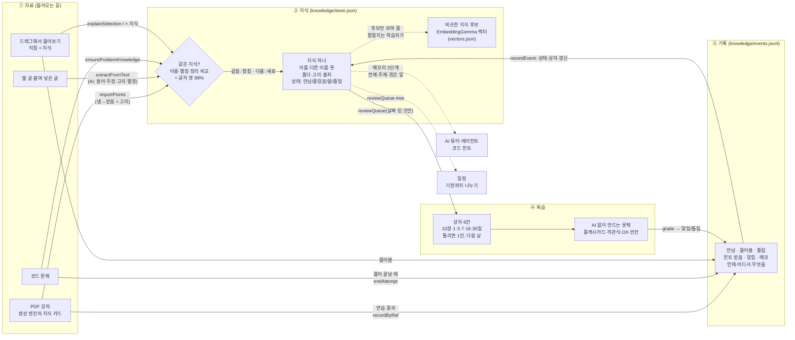

# 지식 저장소 파이프라인 (2026-10-28)

자료 → 지식 → 기록 → 복습이 어떻게 흐르는지, 실제 코드(함수·파일) 기준으로 정리한 문서다. 10/30 교수님 미팅 설명용.

## 한 장 그림

## 몇 문장으로

1. **자료에서 지식을 뽑는다.** PDF는 생성 엔진이 만든 지식 카드를, 웹 글은 AI가 뽑은 용어·주장·고리를, 코드 문제는 그 문제가 확인하는 개념을 "지식"으로 넣는다. 처음 들어온 지식은 **만남**이다.
2. **같은 지식은 하나로 모은다.** 이름과 다른 이름(별칭)을 띄어쓰기·대소문자 없이 비교하고, 아주 비슷한 이름(글자 쌍 88% 이상)도 같은 것으로 본다. 뜻이 같고 말이 다른 것(이진/이분 탐색, Binary Search)은 임베딩으로 **후보만** 찾아 보여 주고, 합칠지는 학습자가 정한다(점수만으로는 "깊이·너비 우선 탐색"처럼 반대 개념도 가깝게 나와서 자동으로 합치지 않는다).
3. **공부한 일은 모두 기록으로 남는다.** PDF 문제를 틀리거나, 코드에서 힌트를 받거나, 글을 드래그해서 물어보면 그 지식에 기록이 붙는다. 틀림·힌트·물어봄이면 **몰랐음**, 힌트 없이 맞히면 **앎**, 서로 다른 3일에 맞히면 **졸업**(복습에서 빠짐).
4. **잊을 때쯤 다시 묻는다.** 지식마다 복습 상자가 있다(10분 → 1일 → 3일 → 7일 → 16일 → 35일). 맞히면 한 칸 올라가고 틀리면 첫 칸으로 가서 다음 날 다시 나온다. 복습 문제는 AI를 부르지 않고 지식에서 바로 만든다. 그 결과가 다시 기록으로 들어가 고리가 닫힌다.
5. **AI는 이 저장소를 읽고 돕는다.** 튜터와 에이전트는 "전체 요약 → 주제 요약 → 겪은 일" 3단계로 학습자의 지식을 읽는다. 일정은 복습할 지식을 기한까지 나눈다.

## 단계별 코드 위치

### ① 들어오는 길

| 길 | 무엇이 들어오나 | 코드 |
|---|---|---|
| PDF | 생성 엔진의 지식 카드(이름·뜻·헷갈림·쪽). 폴더는 `자료 이름 / 구역`. 카드의 **냄 → 받음**은 지식끼리의 고리가 된다(AI 없음). 페이지를 열 때마다 돌아서 예전에 들어온 것도 정리된다. | `src/lib/study/knowledge.ts` `knowledgeLayer` → `src/app/study/DejipgiStudy.tsx` → `POST /api/knowledge/import` → `store.ts` `importPoints` |
| 웹 글 | AI가 용어·원리, 주장 한 줄, 지식 사이 고리, 영어 이름·약어(별칭)를 뽑는다. 글 자체와 목표(용어·주장·고리·알아보기)도 남긴다. | `POST /api/knowledge/extract` → `src/lib/assist/knowledge-ai.ts` `extractFromText` → `saveMany`, `sources.ts` `saveSource` |
| 코드 문제 | 문제를 열면 그 문제가 확인하는 지식(예: 이분 탐색)을 만든다. 출처 `code:<문제ID>`. | `src/lib/code/service.ts` `ensureProblemKnowledge` → `saveMany` |
| 물어보기 | 글을 드래그해 물으면 그 용어가 **몰랐음**으로 들어온다. 지식창의 "+ 지식"으로 직접 넣을 수도 있다. | `knowledge-ai.ts` `explainSelection`, `POST /api/knowledge/item` |

바깥 스레드(코드·생성 엔진·일정·에이전트)는 지식 저장소를 `src/lib/knowledge/api.ts`로만 부른다.

### ② 지식

- 저장: `STUDY_FORGE_DATA_DIR/knowledge/store.json`(폴더·지식), `events.jsonl`(기록), `vectors.json`(비슷한 지식 벡터). 쓰기는 한 번에 하나씩(`serial`) 처리해서 두 화면이 동시에 저장해도 서로 덮지 않는다.
- 같은 지식: `store.ts` `sameAs` — 이름·별칭 정리 후 일치, 또는 4글자 이상 이름의 글자 쌍 유사도 ≥ 0.88.
- 비슷한 지식 후보: `src/lib/knowledge/embed.ts` `similarKnowledge` — EmbeddingGemma 308M(8비트, 한국어·영어 한 모델)을 앱 서버에서 필요할 때 한 번 불러 쓴다. 비교하는 글은 "이름 (다른 이름): 뜻 첫 줄". 글이 바뀐 지식만 벡터를 다시 만든다. 지식창 상세의 "뜻이 비슷한 지식 찾기"에서 후보 5개와 "같은 것 · 합치기 / 관련 · 잇기".
- 빈 뜻·다른 이름 채우기: `knowledge-ai.ts` `fillMissing`(모델 호출 1번, 최대 40개). 비어 있는 곳만 채우고 학습자가 쓴 것은 바꾸지 않는다.

### ③ 기록과 상태

| 일어난 일 | 상태 | 복습 상자 | 어디서 |
|---|---|---|---|
| 만남 | 그대로 | 그대로 | 처음 저장, 다른 자료에서 다시 만남 |
| 물어봄 · 틀림 · 힌트 받음 | 몰랐음, 졸업 풀림 | 첫 칸, 다음 날 | PDF 연습(`recordByRef`), 코드(`endAttempt`), 물어보기, 복습 |
| 맞힘(힌트 없이) | 앎. 서로 다른 3일이면 졸업 | 한 칸 위 | PDF 연습, 코드 제출 통과, 복습 |
| "내 답도 맞아요" | 방금 틀림을 되돌림 | 이전으로 | `takeBackWrong` |

- 모두 `store.ts` `recordEvent` 한 곳에서 처리한다. 기록 시각이 뒤섞여 와도(두 컴퓨터) 복습 날짜는 앞으로만 간다.
- PDF "읽은 직후 확인"은 맞혀도 기억으로 치지 않고, 틀림만 남긴다.
- 코드 풀이 중 힌트·질문·틀린 제출은 "이번 풀이"에 모았다가 맞았을 때·문제를 나갈 때·2시간 뒤에 한꺼번에 기록한다(AI가 방금 준 힌트를 "지난번에도"라고 말하지 않게).

### ④ 복습

- 무엇을: `store.ts` `reviewQueue({ dueOnly: true })` — 날짜가 된 것만, 몰랐음 먼저. 복습할 게 없으면 문제를 내지 않고 "다음 복습은 …"만 보여 준다(`reviewStatus`).
- 어떤 문제로: `src/lib/knowledge/questions.ts` `questionsFor` — 플래시카드(늘), 객관식·OX(같은 폴더·같은 자료의 다른 지식으로 보기), 빈칸(고리가 있을 때). 보기에서 단서가 되는 것(앞의 [맥락], 1) 2) 절차, 유난히 긴 정답)은 뺀다.
- 채점: `questions.ts` `grade`(AI 없음) → `POST /api/knowledge/grade` → `recordEvent`.

### AI가 읽는 기억 (메모리 3단계)

| 단계 | 내용 | 함수 |
|---|---|---|
| 1 전체 | 폴더별 개수, 최근 본 것, 약한 것. 매 대화에 넣을 만큼 짧다. | `memoryOverview` |
| 2 주제 | 한 폴더나 검색 주제의 지식과 약점·고리 | `memorySummary` |
| 3 겪은 일 | 지식 하나·폴더의 기록, 최신순 | `memoryEvents` |

쓰는 곳: 지식 사이드바 질문(`askKnowledge`), 에이전트 툴(`src/lib/agent/tools.ts`), 코드 튜터(`src/lib/assist/code-ai.ts`). 지식창의 "AI가 보는 요약"에서 1단계를 학습자가 그대로 볼 수 있다.

## 아직 안 된 것

- 같은 지식 판정의 마지막 단계(AI가 같음/포함/관련/다름 판정)와 자동 합치기. 지금은 후보만 보여 준다.
- 졸업(서로 다른 3일)과 상자 단계(7일 이상) 맞추기 — 사용자 결정 대기.
- 예전 카드 덱의 FSRS 복습은 지식 복습과 따로 돈다.
- 성취도·약점을 한 화면에 모아 보기, 날짜별 잔디.
