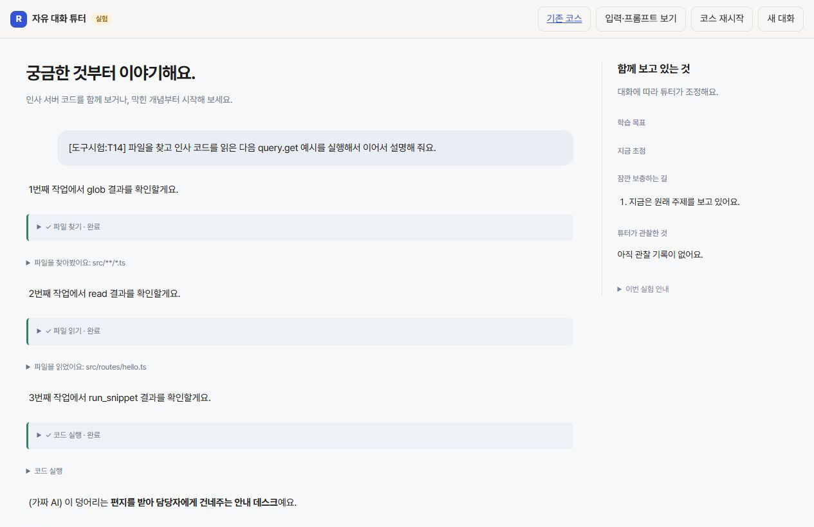

# 대화 중 도구 진행 표시와 전체 도구 호출 테스트

## 결론 (5줄 이내)
- 자유 대화 실험에서 안내 → 도구 진행 행 → 결과 설명을 한 질문 안에서 이어 보이게 구현했다.
- 실제 도구 이벤트로 진행 중·완료·실패·중단을 기록하고, 종료된 이전 답변의 늦은 스트리밍을 무시한다.
- 현재 노출한 7개 도구를 모두 다루는 20문항 테스트지와 자동 연결 시험을 만들었다. 학습 조정 5종·관찰 3종을 포함한다.
- 실제 OpenCode와 가짜 모델로 20/20문항·23회 도구 호출 경로 통과. 전체 테스트는 62/63이며 기존 시나리오 실패 1개가 남았다.
- 실제 AI 호출은 0회다. 가짜 모델의 호출 지정 시험과 실제 모델의 자연어 도구 선택 품질을 구분한다.

## 핵심 표 (하나)

| 확인 | 결과 | 실행 ID · 호출 수 · 시간 · 토큰 |
|---|---|---|
| 새 도구 진행 시험 | 4/4 통과 | 90099 / 실제 AI 0 / 37.38초 / 해당 없음 |
| 전체 도구 통합 시험 | 20/20문항, 23회 실제 도구 실행 | 90099에 포함 / 가짜 모델 / 37.20초 / 실제 AI 토큰 없음 |
| 전체 D 테스트 | 62/63 통과 | 11992 / 실제 AI 0 / 38.36초 / 해당 없음 |
| 여러 도구의 화면 흐름 | 파일 찾기 → 파일 읽기 → 코드 실행 → 답변 확인 | 임시 4194 가짜 서버 / 실제 AI 0 / 미측정 / 해당 없음 |
| 구문 검사 | JS·챗봇 TS·엔진 TS 통과 | 실제 AI 0 / 미측정 / 해당 없음 |
| 대상 타입 검사 | 기존 node:sqlite 타입 누락 2개, 새 파일 오류 없음 | 실제 AI 0 / 미측정 / 해당 없음 |
| D lint·build | 스크립트 둘 다 없음 | f77a24 / 실제 AI 0 / 해당 없음 |
| 첫 통합 시험 | N02에서 실행 오류가 완료로 표시되는 결함 발견 → 수정 후 20/20 통과 | 65061 / 가짜 모델 / 31.96초 / 실제 AI 토큰 없음 |

## Claude가 판단할 것

- 실제 모델이 아래 자연어 질문을 받고 적절한 도구를 스스로 고르는지는 아직 시험하지 않았다. 자동 시험은 식별자에 따라 가짜 모델이 정해진 호출을 내보내고, 실제 SDK·도구·상태 저장·진행 표시를 검증한다.
- 진행 행은 코드가 보장한다. 도구 앞 설명의 문장·길이·필요성은 모델이 정한다. 편집 프롬프트를 보존하므로 사용자가 기존 지시문을 저장해 둔 경우 새 기본 안내 문장이 자동으로 덮어써지지 않는다. 모델이 안내를 생략해도 도구 실행 상태는 표시된다.
- 실제 SDK의 장시간 도구 강제 중단과 실제 모델의 중단 뒤 답변 품질은 별도 확인 대상이다. 자동 중단 시험은 지연시킨 실행 콜백을 이용해 화면 상태 정리와 늦은 결과 무시를 확인했다.
- 기존 scenario.test.ts:97의 '고치기' → '내 말로' 전환 실패는 남아 있다. 이번 변경에서 새로운 전체 테스트 실패는 없었다.

## 자세한 내용

### 1. 구현한 흐름

모델이 내보낸 안내문은 기존 스트리밍 경로를 재사용한다. OpenCode가 실제 도구 실행 직전 execute.before를 호출하면 앞서 쓰던 안내문의 저장을 기다리고 진행 행을 추가한다. execute.after에서 같은 호출 id의 행을 완료·실패·중단으로 바꾼다. 이후 모델은 도구 결과를 받아 다음 설명이나 도구 호출을 이어 간다. 사용자에게 매번 추가 입력을 요구하는 별도 수업 단계로 바꾸지 않았다.

현재 지원하는 표시는 파일 읽기, 파일 찾기, 코드 검색, 코드 실행, 학습 상태 확인, 코스 자료 확인, 학습 목표/초점 조정, 보충 열기/복귀, 학습 관찰 기록이다. 진행 행을 펼치면 경로·검색어·상태 조정 내용이나 오류를 확인할 수 있다. 모델의 내부 생각을 진행 문장으로 만들지 않는다.

정상 실행의 '완료'는 해당 도구가 끝났다는 뜻이다. 학습자가 이해했다거나 프로젝트 검사에 통과했다는 뜻으로 쓰지 않는다. 관찰은 기존처럼 verified=false다.

### 2. 수정 파일

- `lib/tool-progress.ts`: 도구별 진행 문구와 running/completed/failed/cancelled 사건.
- `lib/agent.ts`, `lib/oc-engine.ts`: 선택적인 progress 콜백, 실제 도구 실행 전후 사건, 안내문과 도구 행의 저장 순서 보장. 기존 수업 호출에는 콜백이 없으므로 기존 화면을 바꾸지 않는다.
- `lib/agent-chat.ts`: 같은 호출 id의 진행 행 갱신, 입력 보기용 toolEvents, 응답 종료 시 남은 진행 행 정리, 답변 소유권으로 늦은 스트리밍 차단.
- `lib/agent-chat-policy.ts`: 파일·검색·실행 앞의 필요한 안내와 결과에 따른 후속 설명을 기본 지시문에 추가. 기존의 되묻지 않는 대화 방식과 조용한 상태 기록은 유지했다.
- `web/agent-chat.js`, `web/agent-chat.css`: 단계별 상태 행, 성공·실패·중단 표식, 현재 실행 중인 작업 상태. 진행 상태 자체는 이후 모델 대화 맥락에서 빼서 중복 정보를 줄인다.
- `lib/agent-chat-testcases.ts`, `test/agent-chat-tools.test.ts`: 모든 도구의 문항·가짜 모델 호출 시나리오·실제 실행 결과·순서·종료 상태 검증.

### 3. 테스트지와 실제 검증 범위

[도구 호출 테스트지](C:/Users/jkh01/coding/Recaller/experiments/project-course/docs/도구호출_테스트지.md)에 질문, 사전 상태, 예상 도구 순서, 종료 상태, 확인할 결과를 문항마다 적었다.

- T01~T06: read·glob·grep·run_snippet·get_learning_state·get_course_material.
- T07~T13: adjust_learning의 goal·focus·support·return·observe(understood/confused/misconception).
- T14: 한 질문에서 glob → read → run_snippet을 쓰고 마지막 설명까지 자동으로 이어 가는 흐름.
- T15: 도구가 필요 없는 인사.
- N01~N05: 없는 파일, 실행 오류, 허위 인용, 보충 중복, 오래된 칸 id의 복귀 요청.
- 추가 확인 C01~C04: 중단, 여러 작업의 순서, 같은 답변으로 연속 칸 닫기 방지, 노출 도구 집합.

자동 시험은 mock 결과만 반환하는 시험이 아니다. 가짜 모델이 호출을 고르면 실제 OpenCode의 read/glob/grep, 격리된 코드 조각 실행, 코스 자료 읽기, 학습 상태 저장이 수행된다. 실제 도구 결과가 다음 모델 요청의 tool output으로 들어갔는지 확인한다. 도구 노출 목록도 정확히 7개인지 검사한다.

다만 호출을 고르는 주체는 가짜 모델이다. 따라서 자연어 질문에 대한 실제 모델의 적절한 도구 선택, 설명 내용의 정확성, 학습 진단의 타당성 점수로 계산하지 않는다. 사람용 테스트에서는 식별자 없이 질문을 보내고 실제 function_call·상태 변경·출력 근거를 확인해야 한다.

### 4. 시험에서 발견해 수정한 결함

N02는 코드 조각이 오류를 냈을 때도 OpenCode의 도구 호출 자체는 completed로 끝날 수 있음을 보여 줬다. 처음에는 화면에 '코드 실행 완료'라고 표시돼 시험이 실패했다. SDK가 정규화한 결과 본문이 문자열 또는 text 배열인 경우를 모두 읽고, 코드 실행 오류·학습 조정 거절을 실패로 구분하도록 고쳤다. 수정 뒤 N02·N03·N04·N05를 포함한 20개 문항이 모두 통과했다.

실행이 끝나거나 중단되면 남은 running 행을 실패/중단으로 정리한다. 완료되지 않은 작업을 성공으로 꾸미지 않는다. 답변 소유권 토큰이 끝난 스트리밍 콜백은 저장하지 않으므로 다음 질문에 이전 글이 섞이지 않는다.

### 5. 화면 적용과 운영

임시 4194 서버에서 가짜 모델로 T14를 보내 도구 안내·각 완료 행·마지막 답변을 브라우저에서 확인했다. 시험 데이터는 임시 PC_DATA_DIR로 분리했고 시험 서버는 종료했다. 아래 캡처는 이 가짜 모델 화면이며 실제 로그인 모델의 답변이 아니다.

4100의 정확한 프로젝트 서버 프로세스와 응답 중인 실험 대화가 없음을 확인한 후 새 코드로 적용했다. 3000 앱 서버는 건드리지 않았다. 실제 로그인 모델 호출을 추가로 실행하지 않았다.

