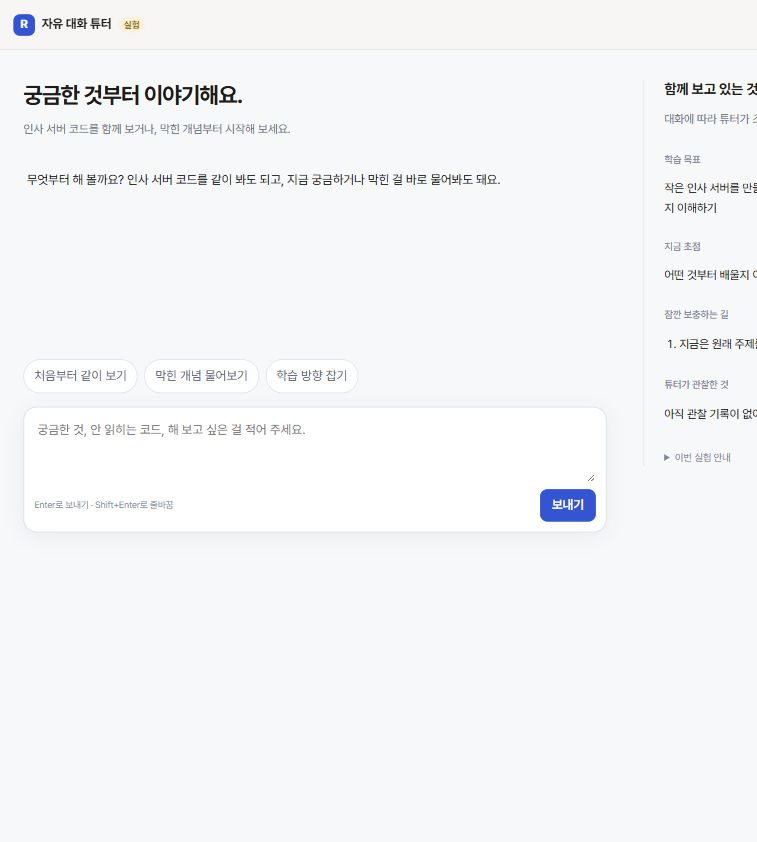

# 자유 대화 학습 에이전트 실험판

## 결론 (5줄 이내)
- 사용자 요청으로 `http://127.0.0.1:4100/agent-chat.html`에 직접 써 볼 챗봇을 추가했다.
- 기존 OpenCode·ChatGPT 로그인·대화 유지·읽기·코드 조각 실행·사용량 기록을 재사용하고, 대본 대신 짧은 전용 지시문을 적용한다.
- AI가 목표·초점·보충 경로·이해도 관찰을 도구로 조정하고, 코드는 입력·인용 근거·칸 id·재진입을 검사한다.
- 실험 기록은 `.data/agent-chat/`에 분리하며 기존 진도·앱 지식으로 보내지 않는다. 실제 AI 호출은 0회다.
- 새 테스트 5개 통과. 전체 57개 중 56개 통과, 기존 초보 시나리오 실패 1개 유지. 브라우저에서 화면과 실제 API 연결을 확인했다.

## 핵심 표 (하나)

| 검증 | 결과 | 실행 ID · 호출 수 · 시간 · 토큰 |
|---|---|---|
| 새 기능 + 기존 맥락 테스트 | 8/8 통과(새 기능 5개) | exec 01f796 / 실제 AI 0회 / 4.02초 / 해당 없음 |
| 전체 D 테스트 | 56/57 통과 | exec 61704 / 실제 AI 0회 / 17.80초 / 해당 없음 |
| OpenCode 실제 도구 경로 | 가짜 모델 → adjust_learning → 초점 변경 → 답 저장 통과 | 새 테스트에 포함 / 실제 AI 0회 / 3.79초 / 해당 없음 |
| 구문 검사 | 새 JS·TS, 엔진·서버 5개 통과 | exec a8fdce / 실제 AI 0회 / 별도 미측정 / 해당 없음 |
| 대상 타입 검사 | 기존 node:sqlite 타입 누락 2개(checker.ts, learn.ts), 새 파일 오류 없음 | exec a8fdce / 실제 AI 0회 / 전체 명령 1.49초 / 해당 없음 |
| D lint·build | 두 스크립트 없음 | exec 7b6792 / 실제 AI 0회 / 해당 없음 |
| 화면·API | 4100에서 새 대화 생성·표시·새로고침 복원 확인 | 브라우저 / 실제 AI 0회 / 미측정 / 해당 없음 |

## Claude가 판단할 것

- 실제 모델의 말투·가르치는 판단 품질은 아직 평가하지 않았다. 사용자에게 별도 모델 호출 승인을 요청하지 않고, 구현·가짜 AI 검증을 마친 상태로 직접 사용할 화면을 열어 두었다. 사용자가 보내는 메시지는 ChatGPT 로그인 사용량을 쓴다.
- 기존 `scenario.test.ts:97`은 정답 저장 뒤 '내 말로' 대신 '고치기'가 반환되어 실패한다. 이번 실험판과 별도이며 앞 검토에서도 재현됐다.
- 이번 판의 학습 재료는 인사 서버 시작 코드다. 자동 검사·파일 수정·실제 코스 진도 변경은 아직 자유 대화 실험의 도구로 연결하지 않았다.

## 자세한 내용

### 쓰는 법

`http://127.0.0.1:4100/agent-chat.html`을 열고 바로 질문한다. 예: “코딩이 처음인데 같이 봐 줘”, “함수 만들기와 부르기가 헷갈려”, “여기까지 내가 뭘 이해했는지 봐 줘”. 오른쪽에서 학습 목표·초점·보충 경로·튜터 관찰을 확인한다. 새 대화 버튼은 독립된 실험 기록을 만든다. 새로고침하면 URL의 chat id로 같은 기록을 이어 간다.

### 구현

- `lib/agent-chat-policy.ts`: 대화 방식의 문장 수·대본·힌트 단계 강제 없이 역할과 도구의 의미를 설명한다. 기존 실험방의 프롬프트 덮어쓰기와 분리한다.
- `lib/agent-chat.ts`: 대화·학습 상태 저장, 단일 대화 재진입 방지, 스트리밍, 오류 보존, 재개 맥락, 자료 조회, 상태 도구. 기존 store·course·stagegen·OpenCode를 재사용한다.
- `lib/oc-engine.ts`, `lib/agent.ts`: 선택적인 learningChat 모드만 추가했다. 이 모드에서 전용 지시문과 terra low를 적용하며 read/glob/grep·run_snippet·학습 도구 셋을 노출한다. 기존 코스에서는 기존 도구·지시문을 유지한다.
- `server/main.ts`: `/api/agent-chat` 생성·조회·질문·멈추기 경로를 추가했다.
- `web/agent-chat.*`: 자유 대화, 코드 블록, 초안 보존, 응답 중 멈추기, 상태 패널. 모델 문자열은 textContent로 표시하고 HTML로 실행하지 않는다.

### 상태 변경의 의미

`goal`, `focus`, `support`, `return`, `observe`를 AI가 선택한다. 이해도 관찰은 `verified:false`이며 학습자 메시지 id와 실제 포함된 문장 인용이 필수다. 보충 복귀는 현재 칸 id와 보충을 연 뒤 받은 답을 검사한다. 위 칸으로 복귀하면 같은 답을 재사용해 연속 닫지 못한다. 코드가 답의 의미를 채점했다고 기록하지 않는다.

기존 수업 엔진의 규칙을 완화한 것이 아니라 별도 모드로 만들었다. 기존 코스 기록과 달리 실제 구현의 독립 통과를 주장하는 경로가 없다.

### 확인하지 않은 것

실제 로그인 모델 응답, 장시간 대화 품질, 모바일 실기기, 실제 코스 편집·검사는 확인하지 않았다. 새로 연결한 OpenCode 도구 경로는 가짜 모델로 검증했다. 3000번 앱 서버·로그인·환경 설정은 바꾸지 않았다.

