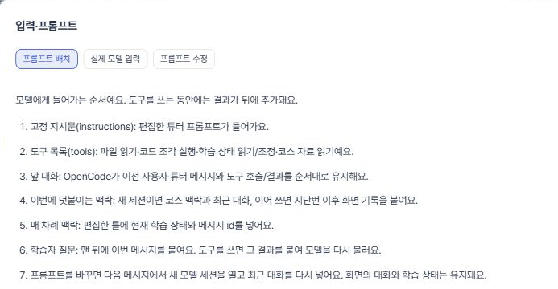

# 학습 에이전트 입력 보기·프롬프트 편집·재시작

## 결론 (5줄 이내)
- 자유 대화 실험 상단에 [입력·프롬프트 보기]와 [코스 재시작]을 추가했다.
- 배치 순서·다음 차례 미리 보기·마지막 답변의 실제 모델 요청을 구분하며, 도구 전후 요청을 각각 볼 수 있다.
- 고정 지시문·코스 맥락·매 차례 틀을 편집하고 저장하면 다음 메시지부터 적용된다. 대화·학습 상태는 유지한다.
- 재시작은 기존 기록을 남기고 초기 상태·새 코드 폴더로 시작한다. 편집 프롬프트는 유지한다.
- 관련 테스트 12/12, 전체 58/59(기존 시나리오 실패 1개). 브라우저 확인 완료. 실제 AI 호출 0회.

## 핵심 표 (하나)

| 확인 | 결과 | 실행 ID · 호출 수 · 시간 · 토큰 |
|---|---|---|
| 자유 대화·맥락·프롬프트 테스트 | 12/12 통과 | dc96e7 / 실제 AI 0 / 4.01초 / 해당 없음 |
| 전체 D 테스트 | 58/59 통과 | 13429 / 실제 AI 0 / 17.68초 / 해당 없음 |
| OpenCode 가짜 모델의 실제 요청 기록 | 도구 전후 본문 2개 이상, 도구 목록·결과 보존 확인 | 관련 테스트에 포함 / 실제 AI 0 / 3.73초 / 해당 없음 |
| 브라우저 | 배치 표시·기존 실제 요청 약 20,030자·편집 화면·동일 내용 저장 확인 | 실제 AI 0 / 미측정 / 해당 없음 |
| 대상 타입 검사 | 기존 node:sqlite 타입 누락 2개, 새 파일 오류 없음 | 실제 AI 0 / 미측정 / 해당 없음 |
| D lint·build | 스크립트 둘 다 없음 | 308dd8 / 실제 AI 0 / 해당 없음 |

## Claude가 판단할 것

- 기존 scenario.test.ts:97 실패는 유지된다. 이번 변경에서 다른 테스트 실패는 없었다.
- 실제 로그인 모델에 새 프롬프트를 보내는 품질 시험은 하지 않았다. 가짜 모델의 요청 훅을 통해 본문 기록·도구 결과·프롬프트 적용 경로를 확인했다.

## 자세한 내용

- `lib/agent-chat.ts`: 전용 프롬프트 저장·검증, 내용 해시별 모델 세션, 입력 추적, 이전 로그 조회, 재시작. 고정 지시문·코스 맥락·매 차례 틀은 각 40,000자까지 편집한다. 빈 글도 그대로 적용한다.
- `lib/agent.ts`, `lib/oc-engine.ts`: 선택적인 전용 지시문·최종 요청 본문 기록 콜백. 실제 로그인은 Responses 본문, 가짜 모델은 Chat Completions 본문을 요청 훅에서 저장한다. 인증 헤더는 저장 콜백에 넘기지 않는다.
- `server/main.ts`: debug·prompts·restart API를 추가했다.
- `web/agent-chat.*`: 모달의 배치/실제 입력/편집 탭, 호출 선택, 미리 보기, 저장·기본값, 재시작 버튼. 폴링 중 옛 대화 응답이 재시작한 화면을 덮지 않도록 대화 id를 확인한다.
- 입력 추적은 마지막 질문 하나의 요청 묶음을 보존한다. 그전 기록은 기존 `.data/prompts/` 로그에 남는다. 기능 추가 전 대화는 최근 100개 요청 로그에서 해당 대화의 마지막 본문을 찾는다.
- 프롬프트 편집은 자유 대화 실험판 전체에 적용된다. 기존 코스의 프롬프트 설정은 바꾸지 않는다. 프롬프트를 바꾸면 다음 질문에서 새 모델 세션에 최근 대화를 넣는다.
- 재시작 API는 응답 중 실행을 거절한다. 이전 대화·코드 폴더는 보존하며 새 id·초기 학습 상태·새 코드 폴더를 만든다. 편집 프롬프트는 유지한다.
- 서비스 적용을 위해 정확히 확인한 프로젝트 서버 PID만 종료하고 4100을 새 코드로 다시 실행했다. 3000 앱은 건드리지 않았다.
- 실제 사용자 대화를 재시작하지 않았다. 재시작·이전 기록 보존·편집 프롬프트 유지·응답 중 재시작 거절은 임시 데이터 테스트로 확인했다.

