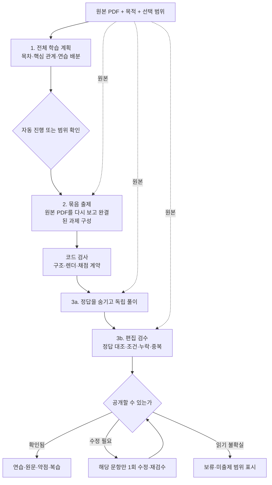

# Recaller 생성 엔진 재설계안

## 결론

현재 병목은 모델보다 **원문을 잘게 요약한 뒤 ‘목표 하나=문제 하나’로 굳히는 구조**다.
추천은 **전체 PDF로 학습 범위를 잡고 → 연결된 과제 묶음으로 출제 → 답을 숨긴 풀이와 원문 대조 후 공개**하는 구조다.
목차·원문 연결·중단 후 재개·선택 재생성은 살리고, 내용 성격 분류 단계와 낱말 중심 탈락 규칙은 없앤다.
유니브의 장점은 문항당 완결된 판단·적용이고, Recaller가 더해야 할 것은 신뢰할 수 있는 범위 보장과 복습 연결이다.
설계·저장본 분석만 완료했다. 신규 모델 호출 0회이며, 새 엔진의 품질 우위·비용 절감은 아직 입증하지 않았다.

## 1. 분석 범위와 증거의 수준

- 코드 기준: `origin/claude/local-state-20260928`의 `35e64579abb9fb57749df8e6f41ae0aa815bbbaa`. 원격을 확인하고 해당 커밋을 연구 데이터에 따로 펼쳐 읽었다. 기존 연구 브랜치의 제품 파일을 교체하지 않았다.
- 읽은 주요 실행 코드: `src/lib/study/gen/`의 runner/prompts/checks/layout/judge/vision/pastexam/schemas/types/pages/guide/scorecard/fake, 출제기준·평가기준, `tools/problem-authoring-lab/quality.ts`, PDF 전달 경로. 기존 테스트는 관련 검사항목을 확인했으며 실행하거나 추가하지 않았다.
- 실제 결과: 그래픽스03 81문항, 그래픽스04 84문항의 문항·목표·분류·요청·재시도와 쪽 읽기 결과. 연구 폴더 8실행의 비용을 집계하고, 빠진 부모 실행은 사용자 데이터에서 읽기만 했다.
- 경쟁 결과: 저장된 유니브03/04/반도체07 기본형, NotebookLM·RemNote 결과 텍스트와 보관 목록. 새로 서비스에 접속하거나 생성하지 않았다.
- 기존 연구/판정 보고서는 보충 근거로만 썼다. 예전 판정단의 허용답 누락·맨손 정답 오탐은 최신 코드에서 일부 보완됐으므로 그대로 현재 결함이라고 쓰지 않았다.
- **관찰**은 저장 결과/코드에서 확인한 것, **원인 추정**은 관찰을 설명하는 경로, **설계 가설**은 앞으로 확인할 변경이다. 원인 분리 실험을 하지 않았으므로 개별 규칙의 인과 효과 크기는 미측정이다.

문항 원문·호출 원문·실제 자료는 공개하지 않는다. 비공개 근거 위치:
`RecallerData-research/engine-redesign-20261019/문항근거와_분석.md`, `trace.json`, `metrics.json`, `archive-metrics.json`, 두 실행의 `*-items.md`.
이번에 PDF 원본 이미지를 전부 새로 읽어 정답률을 측정한 것은 아니다. 쪽 읽기 결과와도 모순되는 결함은 확인했지만, 그 쪽 읽기 자체의 시각 인식 정확도는 별도 검증 대상이다.

## 2. 현재 엔진: 문제가 어디에서 생기는가


### 2.1 최초 오류 지점과 증거

문항 ID는 실행마다 재사용되므로 아래 ‘03/04’와 함께 해석한다. 상세 문구와 쪽은 비공개 근거 E01~E08에 있다.

| 문제 | 실제 근거 | 발생 경로 | 현재 검사로 놓치는 이유 |
|---|---|---|---|
| 조건 누락이 뒤 단계에서 사실로 굳음 | 03 `q-s5-o8` / E03 | 쪽 읽기에는 두 조건이 있지만 분류 요약에서 일부 손실 → 목표가 일반화 → 문항도 반복 | 인용이 원문에 있는지만 검사하며 주장 전체를 지지하는지 안 봄 |
| 문제에 필요한 단서를 검사 때문에 삭제 | 03 `q-s5-o5`, 04 `q-s3-o5` / E01 | 제공 기호/수치와 정답이 겹쳐 오류 → 재출제하며 제공 정보를 제거 | 문제의 재료와 구해야 하는 관계를 구분하지 않음 |
| 진짜 정답 노출은 남음 | 03 `q-s6-o5`, `q-s1-o7` / E02 | 목표의 대응 관계를 질문이 그대로 제공 | 짧은 숫자·한영 표현·의미적 단서는 문자열 검사 사각지대 |
| 이유·비교 누락 | 04 s3 분류·설계 / E05 | 이유가 ‘설명’으로 분류되고, 핵심 선정은 지식/패턴 중심. 전역 이유·비교 점검 없음 | 생성된 목표를 다 채웠는지만 보면 처음부터 빠진 학습은 못 찾음 |
| 자잘한 카드 과다 | 04 `q-s5-o1/o2/o3`, 03 s4 일부 / E06 | 짧은 답으로 목표를 나눈 뒤 목표당 정확히1문제 | 추가 학습 가치·소요 시간·중복 관계를 평가하지 않음 |
| 목표를 부분적으로만 연습 | 03 `q-s3-o6` / E07 | 복수 성분 관계를 한 성분만 묻고 목표 ID 연결 | 문항 존재와 목표 달성을 혼동 |
| 근거가 다른 주장에 붙음 | 03 `q-s2-o3` / E04 | 분류에서 두 내용을 묶은 뒤 목표만 나누고 인용은 복사 | `layout.sourceFor`는 목표 근거를 연결할 뿐, 새 문제의 주장과 대조하지 않음 |
| 절차 답이 추상적이라 채점 기준도 빈약 | 04 `q-s8-o11` / E08 | 목표 단계에서 중요한 처리 조건이 빠짐 | 모범 답과 목표가 함께 빈약하면 서로 일치해도 통과 가능 |

### 2.2 코드·규칙에 남은 원인

1. `prompts.ts:designPrompt`는 **분류 항목만** 받는다. `authorPrompt`는 목표·cue·recall·인용·선택 소재만 받는다. 현재 출제자는 원본 PDF나 전체 쪽 내용을 다시 보지 않는다. 앞 단계 요약이 틀리면 출제자에게 복구할 근거가 없다.
2. `목표설계.md`의 `목적-핵심-1/2`는 지식·패턴을 우선하고 보조 설명은 기본 선택에서 뺀다. 설명을 무조건 제외하는 하드코딩은 아니지만, 이유·비교를 반드시 보존할 별도 판단이 없다. 문서상의 역할과 학습 중요도가 섞였다.
3. `authorPrompt`의 “목표마다 문항을 정확히 하나”가 분량을 자동 결정한다. 독립된 **한 수행**을 작게 만드는 대신 **답의 조각**을 작게 만든다. 하나의 목표에 쉬운 확인+적용이 필요해도 배분하기 어렵다.
4. `quality.ts`는 낱말 중복 비율, 짧은 답의 길이/구분자로 노출·복합 답을 판단한다. 실제 재시도 입력에서 순서 조합·행렬 기호·후보 좌표가 걸렸다. 자동 검사는 있으나 학습 목적에 맞지 않는 오탐이 있다.
5. `checks.ts`의 중복 목표 제거는 정규화된 recall 문자열 중심이다. `layout.inspectQuestion`에 한 문항씩 넣으면 문서 전체를 기준으로 하는 중복/분포 검사는 그 호출에서 효과를 내지 못한다.
6. `pageBlock`은 쪽별/전체 글자 상한을 적용한다. `checks.ts`는 쪽 수에 따라 작은 단원을 인접 단원과 합친다. 비용 통제에는 도움되지만, 의미가 아니라 글자·쪽 수 때문에 정보 접근 범위가 변한다.
7. `runner.ts`의 그림 읽기 대상은 글자 수 중심이다. 이미지 전사 결과를 이후 ‘원문’으로 사용한다. 전사 오류를 인용 검사가 다시 승인하는 공통 오류 경로가 생긴다. 원본·전사를 구분해야 한다.
8. 응답 성공 `ok`와 내용 검사 성공은 별개다. 두 번 뒤 일부를 제외해도 실행은 완료될 수 있다. 생성 완료·누락 있음·검증 완료를 분리해야 한다.

### 2.3 판정단은 왜 충분하지 않은가

- 기본 생성의 공개 전 필수 단계가 아니라 별도 실행이다. 주요 두 저장본에서 판정 결과는 확인되지 않았다. ‘판정 통과한 165문항’이라고 부를 수 없다.
- 목차마다 맨손1·원문 학습자3·전문가1, 정상5호출이다. 같은 계열 모델과 같은 전사문을 반복 제공하므로 호출 수가 독립된 정확성을 보장하지 않는다.
- 전문가에게 주어진 답이 판단을 유도할 수 있다. 원문 학습자도 잘못된 문제 조건을 원문 지식으로 보정해 답할 수 있다.
- 최신 `verdictOf`는 노출·목표 불일치·다른 정답 가능성을 ‘의심’으로 둔다. 이는 오탐 방지에는 합리적이나, 공개 여부를 처리하는 별도 정책이 필요하다.
- 목표 목록에 없는 중요한 내용, 문제 간 실질 중복, 한 문제를 더 풀어 얻는 가치가 주 평가 대상이 아니다.
- 결함 심기 시험의 `falseAlarms`는 원본 중 통과 아닌 것을 센다. 원본이 정상이라는 독립 확인 없이는 실제 오탐률이 아니다. 과거 보고서도 이 문제를 지적했다.

## 3. 유니브 기본형과 무엇이 다른가

내부 구조는 알 수 없다. 출력 차이에서 원인을 추정할 뿐 ‘유니브는 이런 프롬프트를 쓴다’고 단정하지 않는다.

| 축 | 유니브에서 관찰한 장점 | Recaller에서 관찰한 상태 | 그대로 모방하면 안 되는 부분 |
|---|---|---|---|
| 문제 단위 | 연결된 계산·판단을 한 번의 완결된 시도로 묶음 | 명칭·중간값 단위가 많지만 좋은 연결 과제도 존재 | 긴 문제일수록 좋다는 뜻은 아님 |
| 묻는 방향 | 목적/상황 → 적절한 방법·다음 결과 | 개념 이름 → 설명/식 회상 비중 큼 | 기본 회상은 필요하며 전부 응용으로 바꾸면 안 됨 |
| 조건 | 진행 방향·반올림 여부·대상 위치를 구체화하는 사례 | 요약에서 빠진 조건이 문항까지 남음 | 유니브04 기본8번에는 조건 모순도 확인 |
| 형식 | 10문항 안에 객관식·OX·단답·빈칸 | 03 자기확인62/81, 04 59/84. 현재 출제 스키마는 선택/단답/자기확인3종 | 형식 개수와 품질은 별개. OX 비율 강제 금지 |
| 전체 범위 | 짧은 첫 연습으로 접근하기 쉬움 | 수식·절차의 더 세부적인 범위를 다룸 | 유니브10문항이 전체 범위를 커버했다고 볼 수 없음 |
| 설명 | 요약과 개념 묶음에서 원인·개선·사용 조건을 연결 | 카드별 설명이 정답을 반복하는 경우가 많음 | 설명을 길게 출력하는 것 자체는 목표 아님 |

흡수할 것은 **상황 단서, 완결된 과제, 읽기와 문제의 연결**이다. 유니브의 문항 수나 형식 비율을 고정 복제하지 않는다. NotebookLM의 여러 읽기 결과물, RemNote의 노트→카드 연결은 제품 출력 재사용의 참고이며, 이번 세 제품의 새 블라인드 평가를 했다는 뜻은 아니다.

## 4. 현재 비용: 실측과 범위 구분

그래픽스03은 **44쪽**이다. 요청한 31쪽 비교에는 그래픽스01의 저장된 전체 실행을 사용했다. fork의 출제 비용을 전체 생성 비용과 비교하지 않는다.

| 자료/실행 범위 | 호출 | 입력 토큰 | 출력 토큰 | 호출 시간 합 | 경과 시간 |
|---|---:|---:|---:|---:|---:|
| 31쪽 전체 실행(01 부모) | 55 | 132,376 | 33,482 | 846초 | 641초 |
| 31쪽 최종본 출제만 | 8 | 35,014 | 11,501 | 225초 | 225초 |
| 44쪽03 부모 준비+최종 출제 | 51+10 | 179,048 | 54,597 | 1,282초 | 두 실행 사이 대기 제외한 단일 실측값 없음 |
| 52쪽04 전체 | 79 | 218,961 | 68,014 | 1,409초 | 868초 |

52쪽 단계별:

| 단계 | 호출 | 입력 | 출력 | 시간 합/초 | 반복 시도 |
|---|---:|---:|---:|---:|---:|
| 그림 읽기 | 51 | 111,166 | 19,439 | 470 | 0 |
| 목차 | 1 | 15,819 | 1,039 | 21 | 0 |
| 분류 | 9 | 24,037 | 13,668 | 267 | 1 |
| 목표 | 8 | 21,234 | 11,594 | 228 | 0 |
| 출제 | 10 | 46,705 | 22,274 | 422 | 2 |

시간 합은 병렬 호출 때문에 사용자 대기시간과 다르다. 입력 토큰은 재전송을 포함한다. 캐시 할인·추론 토큰·실제 결제액은 이 기록으로 분리할 수 없다.

### 낭비 상위3

1. **거의 모든 쪽을 먼저 전사**: 52쪽 중51쪽, 호출의65%, 입력의51%. 전체 PDF 출제가 가능하면 이 선행 출력은 없앨 수 있다. 다만 PDF 이미지 입력 토큰은 여전히 든다.
2. **분류→목표의 연속 중간 설명**: 52쪽에서17호출·출력25,262토큰. 내용을 두 번 풀어쓰며 조건은 오히려 손실된다. 전체 계획 한 번으로 통합할 가치가 크다.
3. **검사 오탐과 반복 비교**: 03 출제 재시도4회의 입력15,581·출력2,145. 04 재시도3회 입력10,628·출력2,459. 기출형04는 출제/복제검사 등을 합쳐24호출·입력215,286으로 기본 출제 입력의4.61배. 실패한 문항만 수정하는 기존 방식은 살리고, 불필요한 탈락과 기출 원문 반복 전달을 줄여야 한다.

이 셋을 모두 ‘전량 낭비’로 계산하지 않는다. 그림 해독과 검수는 필요하며, 줄일 대상은 별도 전사·중복 중간문서·잘못된 재시도다.

## 5. 추천 구조

### 5.1 대안

| 안 | 장점 | 약점 | 판단 |
|---|---|---|---|
| 전체 PDF → 모든 문제 한 번 | 가장 단순, 첫 호출 수 적음 | 범위 누락·긴 출력·부분 재개·오류 복구가 어려움 | 비교용 단순 기준선으로만 유지 |
| 전체 PDF → 상세 지식 DB → 목표 → 출제 | 세밀한 통제 | 다시 중간 요약이 원문을 대체하고 출력이 비대해짐 | 비추천 |
| **전체 PDF → 간결한 학습 계획 → 묶음 출제 → 독립 풀이/최종 검수** | 전체 맥락, 부분 재개, 범위/품질 확인을 함께 확보 | PDF 반복 입력 비용, 검수 시간 | **추천** |

‘통째 입력’은 첫 단계만 PDF를 본다는 뜻이 아니다. **출제·원문 검수에도 원본 PDF를 제공한다.** 계획은 탐색 지도이지 원문 대체물이 아니다.



### 5.2 단계1: 전체 학습 계획

입력: 원본PDF, 목적, 범위, 사용자 메모, 지원 가능한 문제 화면 목록. 기출형이면 별도로 만든 **추상적인 출제 경향**만 추가한다.

출력은 아래 두 덩어리를 한 응답에 담는다.

- **자료 지도**: 원문 목차와 쪽, 핵심 개념/관계, 조건, 읽기 불확실 위치. 목적이 바뀌어도 재사용.
- **이번 학습 계획**: 어떤 내용을 어느 행동으로 확인할지, 어떤 관계를 함께 묶을지, 필수/추가 연습, 예상 문제 수 범위. 목적에 따라 변경.

모든 문장을 분류하지 않는다. ‘지식/설명/예시’라는 이름 때문에 중요도를 정하지 않는다. 원리의 이유가 중요하면 이유 자체를 핵심으로 고른다. 학습대상1개가 문제1개일 필요도, 문제1개가 개념1개일 필요도 없다.

문항 예산은 페이지당 정수 공식이 아니라 사용자의 목적·시간과 핵심 범위로 정한다. 기본안은 ‘필수 연습’과 ‘더 연습’ 분리. 처음부터 전부 풀어야 하는 긴 덱으로 보이지 않게 한다. 필수 범위를 예산 안에 담지 못하면 누락을 숨기지 않고 추가 필요를 표시한다.

프롬프트 초안:

> 첨부 PDF 전체를 읽고, 이 자료를 공부한 사람이 반드시 기억하거나 판단할 내용을 계획하라. 원문의 목차는 탐색용으로 유지하되 문제 수를 목차 수나 문장 수와 같게 만들지 마라. 이유·비교·조건·절차가 함께 있어야 의미가 보존되면 한 학습 묶음으로 다뤄라. 각 묶음에 어떤 수행으로 이해를 확인할지와 필요한 근거 쪽을 적어라. 이미 있는 공식을 읽어 대입만 하게 할지, 공식을 떠올리게 할지는 목적에 맞게 구별하라. 읽을 수 없는 곳은 추측하지 말고 표시하라.

### 5.3 단계2: 묶음 출제

입력: 전체PDF + 계획 + 이번 묶음의 범위 + 앞서 만든 문제의 짧은 목록(무엇을 이미 물었는지). 이전 문제 원문 전부를 반복하지 않는다.

출력: 문제·답·짧은 이유·필수 채점 요소·원문 근거·어느 학습 내용을 실제로 확인하는지.

- 한 번에12~20문항을 출발점으로 잡되, 긴 과제는 더 작게 묶는다. 숫자는 첫 실험값이지 영구 규칙이 아니다.
- **문제 하나=한 번의 집중된 수행**. 픽셀 선택과 갱신처럼 함께 처리하는 것은 한 문제로 가능하다. 서로 무관한 암기 항목을 한 문제로 묶지는 않는다.
- 형식은 회상 카드/단답/선택/OX/빈칸/구조·순서. 각 형식에 필요한 화면·채점 계약이 있을 때만 활성화한다. 지원하지 않는 형식을 슬쩍 자기확인으로 바꾸지 않는다.
- 핵심 회상과 판단·적용을 목적별로 배분한다. ‘시험 대비’에서도 공식을 주는 문제만 만들어 공식 회상을 빠뜨리지 않는다.
- 이미지가 필수면 원본 쪽/영역을 연결한다. AI가 같은 그림을 다시 그려 원본처럼 취급하지 않는다. 영역 좌표가 불확실하면 전체 쪽을 쓰되 답 노출 여부를 검수한다.
- 각 문제는 앞 문제를 읽지 않아도 풀 수 있게 한다. 공동 지문을 쓰는 경우 공유 지문 ID를 명시한다.

프롬프트 초안:

> PDF와 학습 계획을 함께 보고 이번 묶음의 문제를 만들어라. 정답 이름을 주고 특징을 반복시키는 방식만 쓰지 말고, 필요한 경우 상황에서 방법을 고르거나 결과와 이유를 구하게 하라. 주어진 정보와 학습자가 알아내야 하는 정보를 구분하라. 제공된 기호·후보·숫자가 답에 다시 등장해도 괜찮지만, 알아내야 할 관계까지 알려주면 안 된다. 조건·단위·기호의 뜻은 문제만 보고 알 수 있게 하라. 근거는 답과 조건을 실제로 뒷받침하는 원문 위치로 선택하라. 범위를 채우기 위해 자잘한 문제를 늘리지 마라.

### 5.4 단계3: 독립 풀이 → 편집 검수

**3a 독립 풀이**: 묶음당1호출. 원본PDF+학생 화면만 제공한다. 정답·해설·목표의 정답 문구는 숨긴다. 풀 수 있는지, 필요한 조건이 있는지, 자신의 답과 근거를 짧게 반환한다. 모델의 사고 과정 전체를 저장할 필요는 없다.

> 모범 답을 보지 않고 문제를 풀어라. 문제에 없는 조건을 PDF에서 임의로 보충해 정상 문제로 간주하지 마라. 조건이 부족하면 필요한 조건과 가능한 다른 답을 적어라. 질문 자체가 답을 알려 주면 어느 관계가 노출됐는지 짧게 지적하라. 이미 알고 풀었다는 사실만으로 노출이라고 판단하지 마라.

**3b 편집 검수**: 정상경로 전체1호출. 원본PDF+계획+문항/정답+독립 풀이를 비교한다. 앞 검사는 답을 못 봤으므로 자기 답에 끌려가는 문제를 줄인다. 편집자는 불일치 문항뿐 아니라 전체 범위·중복·누락도 본다.

> 출제 답과 독립 풀이를 원문으로 대조하라. 둘이 같아도 같은 오독일 수 있다. 문항의 조건·정답·근거·허용 답안을 각각 판단하라. 전체 PDF에서 반드시 다뤄야 하지만 계획과 문제 모두에서 빠진 내용도 찾으라. 단어가 겹친다는 이유로 순서·대응·계산 문제를 버리지 마라. 수정은 문제가 있는 ID에만 제안하고, 중복이 의도된 반복이면 추가 학습 가치를 설명하라.

원문에 모순이 있거나 읽을 수 없으면 ‘문제 오류’와 ‘자료 불확실’을 구분해 보류한다. 모델 검수도 오류가 있으므로 통과를 진실 보장으로 표시하지 않는다.

최초에는 전역 검수 후 공개한다. 첫 문제를 더 빨리 공개하는 방식은 별도 최적화 대상이다. 기존처럼 부분 결과를 저장·재개하는 기능은 유지한다. 속도를 위해 검수 전 문제를 검증 완료인 것처럼 학습 목록에 붙이지 않는다.

## 6. 출력 스키마 초안

구현 코드가 아니라 의미 계약 초안이다. 필드별 엄격 JSON Schema 변환은 구현 때 한다. 아래를 모두 별도 AI 단계로 만들라는 뜻이 아니다. 상태·ID·해시·시간은 앱이 붙인다.

```ts
type Evidence = {
  page: number;                       // PDF 물리 쪽, 1부터
  kind: "text" | "figure" | "table" | "formula";
  quote?: string;                     // 실제 인용만. 해설과 분리
  region?: [number, number, number, number]; // x,y,w,h: 0~1
  supports: string;                   // 무엇을 뒷받침하는지 짧게
};

type Plan = {
  outline: { id: string; parentId: string | null;
             title: string; pages: number[] }[];
  concepts: { id: string; outlineIds: string[]; title: string;
              essentials: string[]; conditions: string[];
              evidence: Evidence[] }[];
  practice: { id: string; conceptIds: string[];
              task: string; priority: "essential" | "extra";
              questionRange: [number, number] }[];
  uncertain: { pages: number[]; reason: string }[];
};

type Question = {
  id: string; practiceIds: string[]; conceptIds: string[];
  // 학습자에게 보여 줄 본문·수식·표·원본 그림 참조만.
  prompt: Block[];
  response: Choice | BooleanAnswer | ShortAnswer | Recall | Cloze | Structure;
  evidence: Evidence[];               // 답 확인 후 제공
  checkedSkill: string;               // 이 문제에서 실제로 확인하는 범위
};
// 각 형식은 자신에게 필요한 필드만 갖는다:
// Choice: options, correctOptionId
// BooleanAnswer: correct, falseStatementCorrection
// ShortAnswer: accepted, numericValue?/unit?/tolerance?
// Recall: modelAnswer, requiredPoints
// Cloze: template, blanks[{id, answer}], answerBank?
// Structure: nodes, edges, hiddenIds, orderMatters, answerBank?
// 공통: shortExplanation. 정답 데이터는 답 확인 전 표시와 분리.

type Review = {
  items: { questionId: string;
           status: "ready" | "revise" | "uncertain";
           issues: { kind: string; reason: string; evidence: Evidence[] }[] }[];
  coverage: { practiceId: string; questionIds: string[];
              status: "covered" | "partial" | "missing"; reason: string }[];
  missedContent: { pages: number[]; reason: string }[];
};
```

단답의 수치 허용오차는 근거 없이 자동 설정하지 않는다. 구조복원의 순서 없는 형제는 집합/관계로 채점한다. 주관식은 정답 요소를 보고 자기확인하는 기존 흐름부터 쓰고, 매 답변마다 모델 채점을 추가하지 않는다. 이 제안은 모든 형식을 당장 구현하라는 범위 확대가 아니다.

## 7. 검사와 오탐 방지

| 구분 | 자동 처리 | 주의 |
|---|---|---|
| 코드의 확실한 오류 | 빈 문제, 존재하지 않는 보기/출처 쪽, 중복 ID, 유효하지 않은 수식/레이아웃, 답 저장 형식 오류, 범위 밖 근거 | 그 문항만 보류. 문구 의미를 자의적으로 바꾸지 않음 |
| 답 문자열 겹침 | 경고 신호로만 전달 | 제공값 선택·순서·대응 문제는 정상일 수 있음 |
| 수치·계산 | 지원 범위의 안전한 식/단위 계산기만 사용 | 임의 생성 코드를 실행하지 않음. 계산기 불지원은 보류/모델 대조이지 오류 확정 아님 |
| 의미·조건·근거 | 정답 없는 풀이+원문 편집 검수 | 의견 불일치 자체는 실패가 아님. 대안 답과 근거로 결정 |
| 누락·중복 | 전체PDF의 계획 밖 누락과 문항 간 추가 가치를 확인 | 생성 계획을 유일한 정답 목록으로 삼지 않음 |
| 화면 | 답 공개 전 표시와 답 뒤 설명의 렌더 확인 | 숨겨진 정답 데이터가 모델에게 안 보이는 것과 사용자 표시의 분리는 각각 보장 |

수정은 문항당1회, 같은 결함 재발 시 보류하고 누락 범위를 남긴다. 범위 누락 보충도1회 묶음으로 제한한다. ‘통과할 때까지’ 무한 재생성하지 않는다. 검수 경고마다 어떤 규칙과 근거 때문에 보류했는지 남겨 오탐을 추적한다.

### 문제 → 설계 대응

| 현재 문제 | 새 구조에서 제거하는 원인 | 남는 위험 |
|---|---|---|
| 요약 과정의 조건 손실 | 출제·검수가 원본 전체에 직접 접근; 조건 필드와 주장별 근거 | 모델도 전체PDF에서 놓칠 수 있음 |
| 이유/비교 누락 | 역할 분류 삭제, 관계 중심 계획, 계획 밖 누락 검수 | 중요도 판단 주관성 |
| 낱말·중간값 문제 과다 | 목표당1문제 삭제; 필수/추가와 과제 단위 배분 | 지나치게 통합된 어려운 문제 가능 |
| 제공값을 노출로 오판 | 단어 겹침 하드 차단 제거; 알아내야 하는 관계 검사 | 의미적 노출 검출도 완벽하지 않음 |
| 출처 링크만 있고 근거는 무관 | 답·조건을 지지하는 evidence를 문제에서 다시 선정 | 잘못 읽은 이미지 인용 |
| 완료인데 범위 비어 있음 | partial/missing·보류를 사용자 범위 표시에 반영 | ‘선택 안 함’과 ‘실패’ 표시 혼동 주의 |
| 답을 보고 맞다고 판단 | 답 없는 독립 풀이를 먼저 저장 | 동일 모델 계열의 공통 오류 |

## 8. 비용 예측: 호출 감소와 토큰 감소는 다르다

공식 [OpenAI File inputs](https://developers.openai.com/api/docs/guides/file-inputs)는 PDF의 글자와 쪽 이미지를 함께 문맥에 넣는다고 설명한다. 파일 ID로 재사용해도 모델 입력 자체가 공짜가 되는 것은 아니다. PDF별50MB 미만, 요청 파일 합50MB 제한도 명시돼 있다(확인일2026-10-19). 계정 공유 경로의 실제 지원/제한은 별도 확인해야 한다.

현재 `chatgpt-provider.ts`는 매 요청에 base64 `input_file`을 보낼 수 있고 store:false이다. 파일ID 재사용·입력 캐시가 구현/실제로 적용됐다고 가정하지 않는다. 전체PDF가 제한을 넘으면 조용히 자르지 말고, 원본 보존 압축/지원 한도 확인 또는 사용자에게 분할 필요를 알린다.

### 정상 경로 예산 가설

| 항목 | 31쪽 | 52쪽 |
|---|---:|---:|
| 예시 문항량(고정 규칙 아님) | 24~40 | 36~60 |
| 계획 | 1회 | 1회 |
| 출제 묶음 | 2회 | 3회 |
| 답 없는 풀이 | 2회 | 3회 |
| 전역 편집 검수 | 1회 | 1회 |
| 정상 합 | **6회** | **8회** |
| 수정+재풀이+재검수 1묶음 추가 시 | 9회 | 11회 |

첫 실험에서는 수정과 누락 보충을 같은 추가 묶음에 넣고, 묶음 한도를 넘는 나머지는 보류한다. 이 운영 한도를 적용할 때 총9/11회 안에서 멈춘다. 모든 보류 문항이 해결된다는 뜻이 아니며, 추가 생성을 허용하면 비용표도 다시 계산해야 한다.

입력 추정식: `전체PDF가 한 호출에 차지하는 토큰 F × 전체PDF 포함 호출 수 + 계획/문항/검수 지시 토큰`.

아래 F는 **실측값이 아니라 민감도 분석 가정**이다. 그림 밀도·detail·모델에 따라 벗어날 수 있으며 상한 보장이 아니다.

| 정상 경로 가정 | 31쪽 | 52쪽 |
|---|---:|---:|
| F 가정 | 30,000~90,000 | 50,000~150,000 |
| 추가 입력 가정 | 20,000~40,000 | 30,000~65,000 |
| 총 입력 예상 | **200,000~580,000** | **430,000~1,265,000** |
| 출력 예상 | 20,000~35,000 | 30,000~50,000 |
| 벽시계 계획 범위 | 5~12분 | 8~20분 |

시간은 계획→출제→풀이→검수의 의존성과 작은 동시 실행을 가정한 운영 예상일 뿐이다. 모델별 실제 속도로 보정해야 한다. 기존31쪽 약11분/52쪽 약14분보다 반드시 빠르다고 보장할 수 없다.

**따라서 첫 구현의 주장은 ‘호출 수 감소+품질 회복’이지 ‘비용 절감’이 아니다.** PDF를6~8번 직접 읽히면 입력은 현재보다 늘 수 있다. 정확한 절감률·달러 비용을 제시하는 것은 지금 근거가 없다. 출력 감소도 문제 수 감소가 섞이므로 동등 범위/동등10문항 비교를 별도로 한다.

초기에는 검증된 현재 기본 모델 수준(Sol·medium 중심)을 유지해 구조 효과부터 비교한다. 모델 저가화·그림 detail 축소·묶음 크기 확대를 동시에 바꾸지 않는다. 파일/프롬프트의 동일 앞부분을 유지해 재사용 여지를 만들되 캐시 적용량은 실제 usage로만 인정한다.

## 9. 재사용과 제품 연결

### 재사용 경계

| 사용 상황 | 재사용 | 새로 판단 |
|---|---|---|
| 같은 자료, 목적 변경 | PDF·자료 지도·확인된 근거 | 연습 배분·새 과제·검수. 기존 문제가 새 목적을 충족하면 연결만 |
| 범위 변경 | 자료 지도, 겹치는 범위의 문제/검수 | 추가 범위와 단원 간 연결 누락 |
| 기출형 | 자료 지도·학습 범위, 기출의 추상 경향 카드 | 과제 구성부터 변경 가능. 출제 문체만 바꾸지 않음 |
| 신고 후 다시 만들기 | 원본·대상 개념·다른 정상 문제 | 신고 원인에 맞춰 조건/정답/과제 수정 후 재검수 |
| 중단 후 재개 | 완료된 묶음과 검수 결과 | 미완료 단계만 |

재사용 키는 PDF 내용 해시·범위·목적/지시·모델/프롬프트/출력 버전을 기록한다. PDF가 같다는 이유만으로 오래된 오독을 영구 재사용하지 않는다. 기출 원문은 출제 입력에서 분리하고, 복제 검사는 마지막 묶음 대상으로 실행한다. 문제 유형 분포뿐 아니라 요구 행동·조건 복잡성도 경향에 담는다. 확인용 기출은 튜닝에 쓰지 않는다.

### 기존 장점을 살리는 이유

- **목차·쪽 연결**: 오류를 의심했을 때 바로 확인할 근거가 된다. 전체PDF 생성으로 바꿔도 없애면 안 된다.
- **목표/범위 선택**: 사용자가 공부할 범위를 통제할 수 있다. 다만 잘게 나뉜 목표 수십개를 반드시 확인하게 하지는 않는다.
- **부분 저장·재개·다시 만들기**: 큰 자료나 사용량 중단 때 이미 만든 것을 보존한다.
- **약점·복습과 문제 ID**: 새 문제를 만들어도 이전 풀이 기록을 덮어쓰지 않는다. 개념ID와 문항 버전을 분리해 연결한다.
- **서버가 화면 배치와 채점 형식을 처리**: 모델에게 좌표를 그리게 하지 않고 내용에 집중하게 한다.

| 제품 기능 | 새 출력 연결 |
|---|---|
| 읽기 화면의 쉬운 설명 | concepts+원문 쪽으로 온디맨드 설명. 모든 쪽 설명을 생성 선행조건으로 만들지 않음 |
| 용어 정리 | 개념 ID·원문 표현·짧은 정의를 재사용. 문제 정답에서 역추출하지 않음 |
| 목차 표시 | 원문 outline 유지. 출제 묶음 경계와 화면 목차를 같게 강제하지 않음 |
| 약점 | 문항의 실제 checkedSkill/개념과 풀이 결과 연결. 자기확인을 객관적 이해도 확정으로 표현하지 않음 |
| 반복 학습 | 기존 복습 스케줄에 검수된 문제만 연결. 관련 문제의 성공을 개념 전체 완전 숙달로 자동 승격하지 않음 |
| 범위 표시 | 선택 범위 / 출제됨 / 부분만 확인 / 미출제 / 학습함을 구별. 페이지에 문제1개 있다고 그 페이지 전체 완료로 칠하지 않음 |
| 다시 만들기 | 새 문항 버전으로 저장, 과거 기록 보존. 단순히 숫자만 바꿨는지 개선 이유 기록 |

## 10. 검증 계획과 사전 채택 조건

### 10.1 먼저 확인할 핵심 가정: 최대2회로 시작

이번에는 실행하지 않았다. 사용자 공부 서버와 분리된 연구 폴더·3200에서만 진행한다.

1. **“전체PDF에서 작은 행렬/부호를 못 읽으면, 고해상도 보완 또는 해당 범위 보류 정책이 바뀐다.”** 그래픽스04 전체PDF를 넣고 미리 정한2쪽의6~10개 원소/부호/조건을 추출하는1회. 사람이 원본 이미지에서 먼저 정답표 작성. 토큰F와 시간도 기록.
2. 첫 호출이 실패/불명확할 때만 **“보완 입력도 못 읽으면 자동 출제 지원 범위가 바뀐다.”** 같은PDF+문제 영역 고해상도 이미지로1회. 다시 같은 실패면 중단. 전체 자료 새로 만들기는 하지 않는다.

기록은 `가설 → 측정 → 설계 결정 영향` 세 줄. 자료 전송/로그인 지원 여부와 내용 판독을 분리한다. 성공했어도 전체52쪽 정확성을 보장하지 않는다. 31쪽F는 실제 첫 생성 시 기록해 비용표를 갱신한다.

### 10.2 비교 자료와 분리

- 개발용: 그래픽스03,04. 이미 결함을 관찰했으므로 최종 일반화 증거로 단독 사용하지 않는다.
- **확인용 후보: 반도체 공학의 이해03주차**. 이번 설계에서 해당 결과/내용은 열지 않았다. 실험 전 파일·사용 이력을 확인하고 실제로 튜닝에 쓰이지 않은 자료로 고정한다. 반도체07은 이미 비교에 사용했으므로 확인용으로 쓰지 않는다.
- 세 엔진: 현재 고정 커밋 / 새 구조 / 유니브 기본형. 같은 원본 해시·범위·언어·목적. 유니브에 세부 튜닝 지시를 주지 않는다.
- 저장본 비교는 위 관찰의 근거이며, 채택 실험에서는 버전·시간·설정이 기록된 새 결과로 비교한다. 과거 모드/문제 수 차이를 숨기지 않는다.

### 10.3 비교 두 층

**A. 첫10문항 품질**: 각 제품의 기본 생성 순서 첫10문항을 사용해 좋은 것만 골라내지 않는다. 자료3종×엔진3개×10문항=90문항/회. 출처 이름·제품명·디자인·내부ID를 숨기고 보기 순서를 안전하게 무작위화한다. 내용은 고치지 않는다. 형식 차이가 있으므로 완전한 블라인드는 아니라는 한계를 기록한다.

**B. 전체 자료 가치**: 각 엔진의 실제 생성 전체를 범위표와 비교한다. Recaller80개와 유니브10개를 단순 평균점수만으로 비교하지 않는다. 자료당 핵심 커버리지, 중복, 전체 소요/생성 비용을 함께 측정한다. 유니브 추가 생성이 필요하면 ‘기본형’과 별도 조건으로 보고한다.

정답 범위표는 생성 결과를 보기 전에 원본에서 작성한다. 정의뿐 아니라 조건·이유·비교·적용을 자료에 필요한 만큼 넣고, 핵심 가중치는 사전에 고정한다. 계획 모델의 출력으로 정답 범위표를 대신하지 않는다.

### 10.4 채점

문항마다 정답 정확성·조건 충분성·인출 방향·학습 가치·근거 충실성을 각각0~4점. 평균만으로 심각 오류를 상쇄하지 않는다.

- 중대 오류: 틀린 정답, 성립 불가능한 조건, 풀 수 없는 정보 누락, 의도한 답/관계를 미리 공개, 사실상 다중 정답인데 단일 오답 처리.
- 학습 가치: 핵심과의 연관, 단순 문장 복사/숫자 읽기를 넘어 실제로 무엇을 회상·구별하는가. 기본 정의 회상은 낮은 난이도라는 이유만으로 감점하지 않는다.
- 형식 품질: 객관식은 오답의 타당성과 유일성, OX는 한 주장과 교정, 빈칸은 의미 있는 인출 대상, 자기확인은 구체적 필수 요소, 구조복원은 순서 유무에 맞는 채점.
- 커버리지: 사전 핵심 항목 가중치 중 적어도 한 유효 문항이 실질 평가하는 비율. 부분 수행은 부분 점수.
- 비용: 전체/유효 문항당 입력·출력·캐시·추론 토큰, 호출·재시도·첫 유효 문제/전체 완료 시간. 경쟁 서비스 내부 비용은 알 수 없으므로 사용자 측 생성 시간/사용량만 비교한다.

독립 검토자2명이 먼저 판정한다. AI를 쓰면 출제 답을 숨긴 풀이부터 받고, 서로의 의견을 먼저 보이지 않는다. 의견이 갈린 것과 모든 수식/중대 오류 후보는 원본 이미지로 별도 판정한다. 인간 전문 검토를 못 하면 ‘AI 기반 잠정 평가’라고 쓰며 학습 효과 입증으로 확대하지 않는다. 사람의 장기 기억 향상은 별도 연구다.

### 10.5 채택 조건(실험 전 고정하는 제안)

1. 새 엔진 확인용 자료에서 **확인된 중대 오류0개**. 개발용에서도 해결되지 않은 중대 오류는 공개하지 않음. 0개 관측을 실제 오류율0으로 주장하지 않는다.
2. 첫10문항 평균 학습 가치가 유니브보다0.25/4점 이상 높고, 각 자료에서 유니브보다0.2점 넘게 떨어지지 않는다. 조건·정확성 평균도 유니브보다 낮지 않아야 한다.
3. 필수 범위 가중 커버리지90% 이상, 중요한 단원 전체 누락0. 같은 핵심 범위에서 현재 엔진보다 낮아지지 않는다. 유니브10문항의 커버리지가 낮아도 이 조건을 낮추지 않는다.
4. 불필요한 의미 중복10% 이하. 형식의 숫자보다 자료에 필요한 회상/이유/비교/적용의 충족을 본다.
5. 같은 핵심 커버리지에서 유효 문항당 총 토큰이 현재의2배 이내, 전체 완료 시간이1.5배 이내. 넘으면 품질이 좋아도 ‘기본 대체’는 보류하고 고품질 선택 모드 또는 입력 재사용 최적화를 검토한다.

소표본 한 번으로 ‘유니브 이상’을 확정하지 않는다. 첫 회가 조건을 만족하면 프롬프트를 고정한 상태로 각 자료2회 추가해 총3회로 안정성을 본다. 같은 유형의 중대 실패가2회 반복되면 중단·원인 기록. 확인용을 보고 수정했다면 그 자료는 더 이상 확인용이 아니므로 새 보류 자료가 필요하다. 검토자간 일치도·평가 구간과 제품별 생성 변동도 보고한다.

## 11. 이번 산출물·하지 않은 것

- 새 테스트 파일: **없음**. 제품 코드 수정: **없음**. 모델 호출: **0회**. 브라우저/서버 실행: **없음**.
- 연구용 스크립트: 비공개 `engine-redesign-20261019/audit.mjs` 하나. 실제 저장 문항·상태·호출을 펼쳐 조건 손실/E01 재시도/비용을 추적하기 위해 사용. 상시 저장소 도구로 추가하지 않았다.
- 사용자 RecallerData는 읽기만 했다. 동기화·기록 변경·3000서버 조작 없음.
- 미검증: 전체PDF 새 경로의 계정 지원·수식 판독, 새 출력의 실제 화면 호환, 비용 범위, 유니브 대비 우위.

## 12. 사용자가 결정할 것 / Claude가 판단할 것

추천안은 다음 결정까지 포함한다. 구현 시작 전 아래만 확정하면 된다.

1. **기본 목표를 ‘짧은 필수 연습+더 연습’으로 바꿀지.** 추천은 바꾸는 것. 기존처럼 모든 조각을 기본 덱에 넣으면 출제 품질을 높여도 공부 부담이 남는다.
2. **입력 비용이 늘어날 가능성을 감수하고 품질부터 확인할지.** 추천은 작은 비교 실험부터. 현재는 비용 절감 약속을 할 수 없다. 채택 조건의2배/1.5배 한도는 제안값이다.
3. **검수 후 공개로 첫 대기를 늘릴지.** 추천은 최초 버전에서는 검수 후 공개. 부분 저장/재개는 유지하고, 빠른 공개는 검수 품질이 확인된 뒤 별도 최적화한다.
4. **문제 형식 구현 범위.** 먼저 현재 화면이 정확히 지원하는 형식으로 구조 효과를 비교한다. OX/빈칸/구조복원 확장은 계약·채점·화면 지원이 확인된 것부터 켠다. 전 형식 신규 구현을 이번 연구의 결론으로 자동 승인하지 않는다.

PDF 통째 입력은 이미 결정된 전제이므로 다시 선택을 요청하지 않는다. 남은 질문은 그것을 얼마나 자주 읽히고, 무엇을 검수한 뒤, 어떤 분량으로 사용자에게 보여줄지다.
